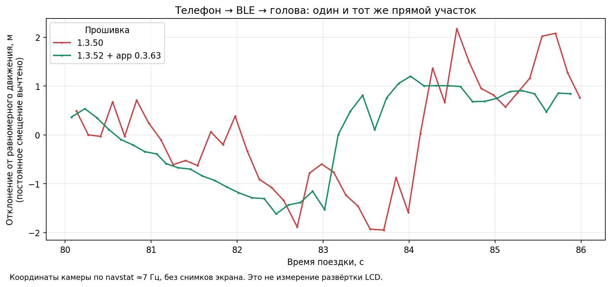

# Physical phone navigation test — 2026-11-20

Firmware **1.3.52**, companion **0.3.63+127**. Samsung Galaxy A23 5G,
JC4880, real Android BLE and head-unit display. The production app already on
the phone had a different signing certificate and was preserved. Tests used
the separate `com.aabridge.aa_bridge.navtest` package.

## Inputs and path

The fixed Rynek–Kazimierz geometry contains 169 points and road/cycle/foot
segment types, saved by the earlier 2026-11-19 route regression. It is now in
`flutter-application/tool/nav_phone_fixture.dart`.

`simulateRide` supplies 1 Hz GeoFix events at 5 m/s, 1× monotonic wall time,
through the normal `NavController.attachFixes`, `NavigatorScreen`,
`HeadUnitFeed`, service IPC, Android BLE and head renderer. Head zoom is 17,
camera AUTO. A preloaded route supplies the geometry; routing optimality and
real GNSS reception are not evaluated. Raster tiles use the normal app cache
and Bluetooth transport, with no usable SD card on the bench head.

The final run holds its first point for 20 seconds, rides the unchanged first
120 seconds, then injects a point eight metres before the original destination
to check arrival. This final jump is artificial. A complete older 1.3.51 run
exposed the arrival bug, but a complete end-to-end ride with the final app was
not repeated. See [harness instructions](../flutter-application/tool/PHONE_DRIVE.md).

## Defects found and corrected

1. Repeated GPS anchors reset an advancing prediction; fractional e7 movement
   and world-pixel precision also caused stops/rollback. The production motion
   and projection helpers were corrected before the physical phone run.
2. Guide-row alignment ran every 25 ms. LVGL writes its alignment style even
   when unchanged, invalidating the widget. Alignment now runs when its
   calculated position actually changes.
3. Connected-state notifications could recreate `NavBackground` without
   disposing the previous instance. UI ownership sent before connection was
   also discarded. Real GPS then competed with foreground simulated fixes.
   A service-lifetime owner now retains the flags, reuses the same channel's
   producer and disposes retired producers. Late permission queries recheck
   ownership before subscribing or starting the background feed.
4. Arrival cancelled simulation before its final zero-speed sample reached
   the controller. The controller now publishes a stopped simulated fix first;
   measured real-GPS speed is preserved.

## Results

Matching observation windows are ride seconds **15–29 and 76–88**. UART
`navstat` samples at approximately 7 Hz, with framebuffer screenshots disabled
in these windows. A backward step is progress below −0.05 m; a near-stationary
step is below 0.025 m in magnitude over a 0.06–0.25 s observation interval.
Progress is projected onto the supplied route, not an independent ground truth.

| Measurement | 1.3.50 / app 0.3.61 baseline | 1.3.52 / app 0.3.63 |
| --- | ---: | ---: |
| Consecutive observation pairs | 180 | 182 |
| Backward camera steps | 11 | 0 |
| Near-stationary camera steps | 16 | 2 |
| New map frames presented to LVGL per second | 4.68 | 6.68 |
| Median map composition, ms | 53.64 | 44.73 |
| Foreign-position samples during moving replay | 0 | 0 |

- **PASS:** final replay completes without a harness error; 121 source fixes
  over the 120-second moving prefix, intervals 0.995–1.006 seconds. The
  controller records consuming the simulated fixes, then zero speed at arrival.
- **PASS:** arrival screenshot shows a stationary dot and remaining distance
  of eight metres, with the orange foot segment and blue road at the finish.
- **PASS:** after a physical head restart, BLE reconnect restores 169 route
  points and raster coverage (12/12 visible tiles). All 94 observed positions
  remain within 0.005 m of the stopped fixture point; real GPS does not resume.
- **PASS:** 62 targeted navigation/BLE Flutter tests, final analysis with no
  issues, and all three P4 firmware builds. APK signature, ZIP CRC, bundled
  firmware hashes and S3 exclusion checked. Release build has no embedded key.

The frame counter measures new map buffers handed to LVGL, **not physical LCD
scanout FPS**. Captures can affect timing; the comparison windows exclude them.
These changes improve the measured case but do not establish high-frame-rate
rendering or absence of all visible pauses. Vehicle riding, final-version full
route replay, simulated source handoff while the phone sleeps, hardware panic
injection, other-board hardware and overnight endurance remain **NOT RUN**.

## Evidence and rejected attempts

[Machine-readable summary](navigation-phone-test-results.json) and the figure
are committed. Raw inputs, timestamps, UART logs and CRC-checked frames remain
under ignored `build/nav-test-runs/stop-go-20261120/`:

- `phone-before-1.3.50-r3`: valid baseline.
- `phone-final-1.3.52-app-0.3.63`: final 180-second observation.
- `phone-reconnect-1.3.52-app-0.3.63`: restart/reconnect observation.

Earlier warmup-only, startup-mode and competing-source runs are rejected.
Their logs are retained with an INVALID marker where applicable. In particular,
0.3.62 performance figures are not used as a clean comparison: the competing
background producer was still present. A running notification-listener process
in the original app alone did not establish that it was the GPS publisher.

The head is left on 1.3.52 in `ota_1`, with the original 1.3.50 application
retained in `ota_0`; the installed phone app and its data were not replaced.
