# Head-unit screens — what each one does

Every screen the LVGL dashboard can show on the 800×480 panel — all four
dashboard themes plus every menu and dialog — with a rendered picture and the
controls on it.

The pictures are **not mock-ups**: they are screenshots of the firmware's own
screens, built for the host with `make menus` (`SIM_SHIM=1` — the real C from
`Super_VESC_Display/custom/` plus `sim_backend/` standing in for CAN, BLE and
flash). Only the numbers are fake, so ignore the values and look at the layout.

---

## Gestures that work on every dashboard screen

| Gesture | Effect |
| --- | --- |
| 3-finger tap | Switch between the dashboard and the phone screen (Android Auto or the built-in navigator — see *Settings → Connection*, §3.1) |
| Swipe right from the left edge | Open **Quick actions** (§10) |
| Tap outside the Quick-actions drawer | Close it |
| Drag horizontally on the dashboard background | Screen brightness (only when **Brightness gesture** is on, §3.2) |
| Tap `VESC`, `STATISTICS`, `SETTINGS` in the top bar | Jump to VESC Config, Trip statistics, Settings |

---

## 1. Dashboard — Cockpit

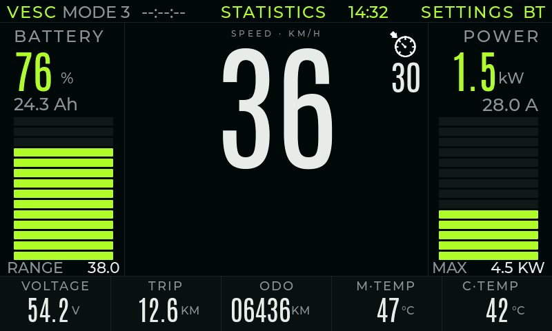

The default screen. One glance: how much battery is left, how fast, how hard
the controller is working.

- **Top bar** — `VESC` (opens the VESC Tool config), `MODE n` (the VESC's active
  LISP speed profile), uptime, `STATISTICS` (trip log), `BT` (lit when a BLE
  peer — phone or sensor — is connected), `SETTINGS`.
- **BATTERY** (left) — charge %, **remaining Ah**, and a bar. The number under
  `RANGE` is the estimated distance left in the pack, from the configured
  capacity and recent consumption. In `JK-BMS (BLE)` mode the percentage and Ah
  come from the pack itself; with the pack offline they read `N/A`.
- **Battery percentage** is a tap target: it opens the pack screen (§9a), the
  same one as **Settings → Bike → Battery monitor (JK-BMS) → Open**.
- **SPEED** (centre) — the big digits; `MAX 60` is the top of the scale.
- **POWER** (right) — instantaneous power in kW, current in amps, and a bar
  whose full scale is `Power Max` from Settings → Display (§3.2).
- **Bottom row** — pack voltage, trip distance, **odometer** (lifetime, kept on
  the display), motor and controller temperature.

## 2. Dashboard — Classic Max

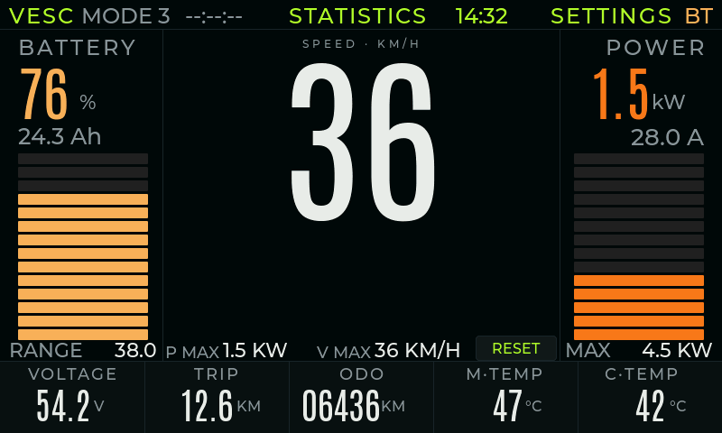

The same dashboard with the trip-comparison extras: `P MAX` (peak power this
session), `V MAX` (top speed) and a `RESET` button in the bottom bar.

`RESET` zeroes the trip counters (distance, Wh, time, peak power, top speed).
The **odometer is not affected** — that is the lifetime total.

## 2a. Dashboard — Cockpit (Amber)

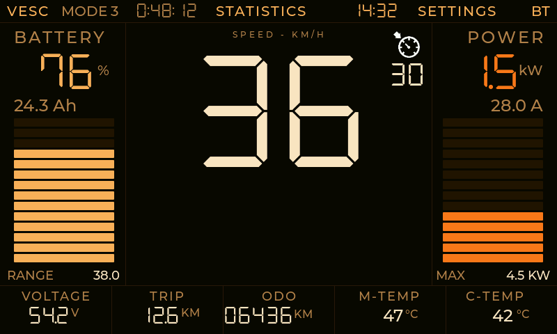

The Cockpit layout in the warm “cyberpunk amber” palette: the same battery,
speed, power and telemetry tiles, but with seven-segment DSEG7 numerals and
amber bars on black. Every control works exactly like Cockpit (§1) — this theme
only changes the look. Pick it in **Settings → Display** (§3.2).

The battery percentage is a tap target for the JK-BMS pack screen (§9a), just
like on Cockpit.

## 2b. Dashboard — Twin Arc

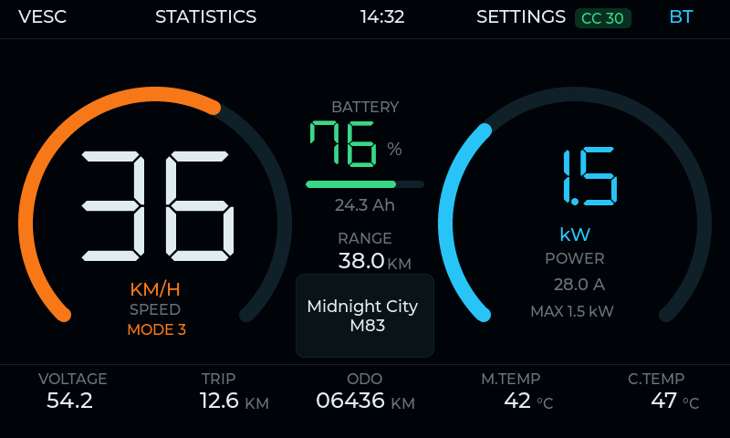

Two 270° rings frame the ride: the orange **speed** ring on the left, the cyan
**power** ring on the right. The centre column carries battery %, a bar,
remaining Ah and estimated range; the wide card underneath is the phone’s
**now-playing** title and artist. The bottom strip shows voltage, trip,
odometer, motor and controller temperature.

- **Top bar** — `VESC`, `STATISTICS`, the clock, `SETTINGS`, `BT`, and a green
  `CC nn` badge while cruise control is active.
- **Speed ring** — `KM/H` (or `MPH`), `SPEED`, and `MODE n`. The ring fills
  against a 0–60 km/h scale and the digits stay inside it.
- **Power ring** — instantaneous `kW`, `POWER`, current in amps and this
  session’s `MAX n.n kW`.
- **Battery %** — tap it to open the JK-BMS pack screen (§9a). In `JK-BMS (BLE)`
  mode an offline pack reads `N/A`; there is no fallback to the controller.

On the 480×480 ESP32-S3 panel only Cockpit and Classic Max are available; the
two wide themes are compiled for the 800×480 boards.

---

## 3. Settings

Settings is one screen with four tabs. Everything on it is saved immediately —
there is no OK / Apply.

### 3.1 Connection

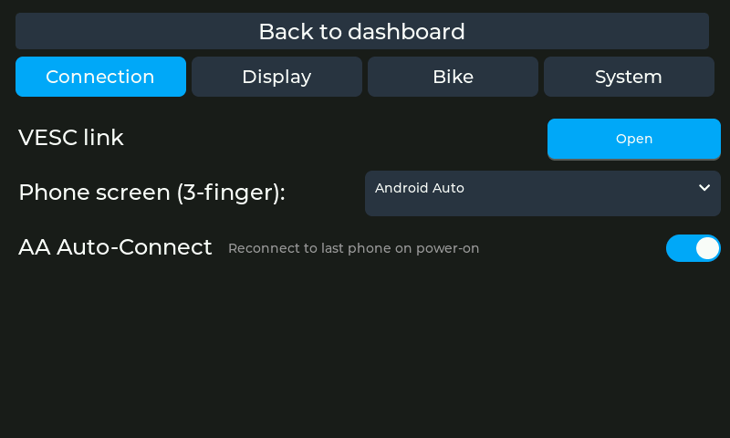

- **VESC link → Open** — the transport screen: CAN or Bluetooth to the
  controller, VESC Express pairing, live link state.
- **Phone screen (3-finger)** — what the 3-finger gesture shows: `Android Auto`
  (the phone projection) or `Navigator` (the companion app's map over BLE).
- **AA Auto-Connect** — let the BT agent page the last paired phone on power-on.
  Off means you start the connection from the phone.

### 3.2 Display

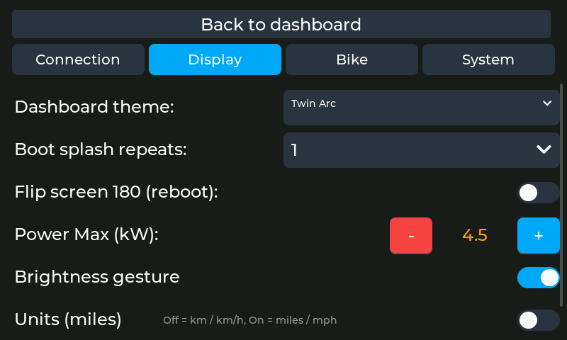

- **Dashboard theme** — `Cockpit`, `Classic Max`, `Cockpit (Amber)` or
  `Twin Arc`; switches live. The last two are 800×480 builds only.
- **Boot splash repeats** — how many times the boot animation loops (`Off`…`5`).
- **Flip screen 180 (reboot)** — for an upside-down mounting; applies after a
  reboot.
- **Power Max (kW)** — full scale of the power bar and the `MAX` label.
- **Brightness gesture** — enable the invisible full-screen brightness slider
  (drag horizontally on the dashboard).
- **Units (miles)** — `Off` = km / km/h, `On` = miles / mph. Applies live to the
  dashboard, trip statistics and the odometer dialog.
- **Temperature (F)** — `Off` = °C, `On` = °F.

### 3.3 Bike

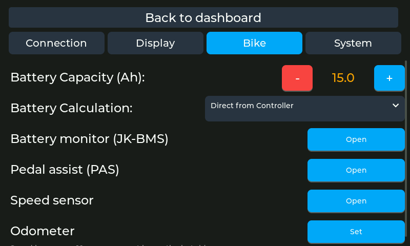

- **Battery Capacity (Ah)** — pack size; drives the % and the range estimate.
- **Battery Calculation** — `Direct from Controller` (use the VESC's own
  percentage), `Smart Calculation` (count Ah in/out against the capacity, with
  charge detection) or `JK-BMS (BLE)` (read SOC, remaining Ah and range from a
  paired Jikong pack).
- **Battery monitor (JK-BMS) → Open** — the pack screen: live state, cells,
  temperatures and Bluetooth pairing (§9a). The same screen opens by tapping
  the battery percentage on the dashboard.
- **Pedal assist (PAS) → Open** — the PAS screen (§8).
- **Speed sensor → Open** — the wheel-sensor screen (§9).
- **Odometer → Set** — re-base the lifetime total (§4). The hint under it is the
  point of the feature: the total is checkpointed here every 10 s, so a key-off
  never loses the end of a ride.

### 3.4 System

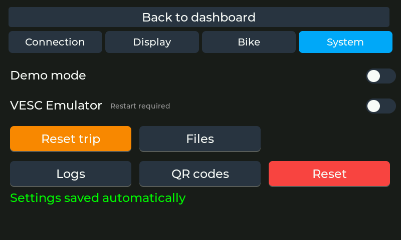

- **Demo mode** — drive the dashboard with synthetic values (shows, photos).
- **VESC Emulator** — pretend a controller is on the bus; needs a restart.
- **Reset trip** — the same as the dashboard's `RESET`.
- **Files** — on-device file browser (littlefs / SD card).
- **Logs** — the log viewer over the in-PSRAM ring buffer.
- **QR codes** — Wi-Fi and firmware-OTA QR codes (§13).
- **Reset** — all settings back to defaults. The odometer, the paired sensors
  and the trip log survive this on purpose.
- Below the buttons: firmware versions (host / BT agent / C6) and CAN bus health.

---

## 4. Set odometer dialog

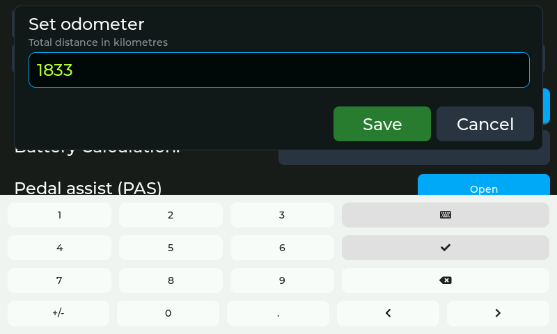

**Settings → Bike → Odometer → Set.**

A modal over Settings with a number keyboard. Use it when the total no longer
matches reality: a replacement controller, a frame swap, a VESC that was
flashed. The value is entered in your units (km or mi), `,` is the decimal
separator, and it is converted before it is stored.

`Save` writes it; `Cancel` (or the keyboard's ✕) leaves the total alone. From
then on the number is kept on the display: the dashboard's `ODO` field and this
dialog always show the same value.

It edits whichever odometer the dashboard is showing — the VESC mirror, or the
BLE wheel sensor's when that is the selected speed source.

## 5. Trip statistics — list

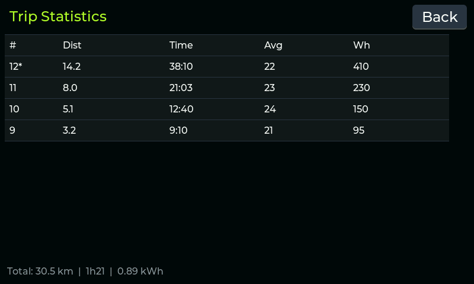

**`STATISTICS` in the dashboard's top bar.**

- Newest trip first; the `*` marks the trip still being recorded.
- Columns: distance, duration, average speed, energy (Wh).
- The footer adds up everything the `triplog` partition still holds (about
  11 days of powered-on time at the 10 s sample rate).
- `Back` returns to the dashboard.

## 6. Trip statistics — detail

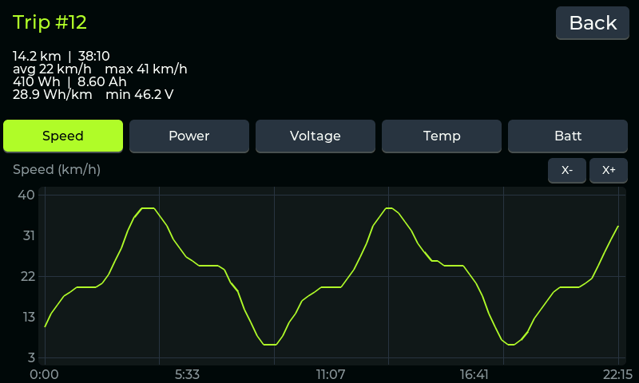

Tap any row in the list.

- Header: distance, duration, average and maximum speed, energy and charge
  (Wh / Ah), efficiency (Wh per km or mi) and the lowest pack voltage.
- Five metric tabs — `Speed`, `Power`, `Voltage`, `Temp`, `Batt` (a second
  temperature tab appears when a second head is enabled) — each redraws the
  chart for the same trip.
- `X÷` / `X+` zoom the time axis; once zoomed, drag the chart left/right to pan.
- `Delete` asks for confirmation and then drops the trip from the log. The trip
  still being recorded (`*`) cannot be deleted.

---

## 7. VESC Config

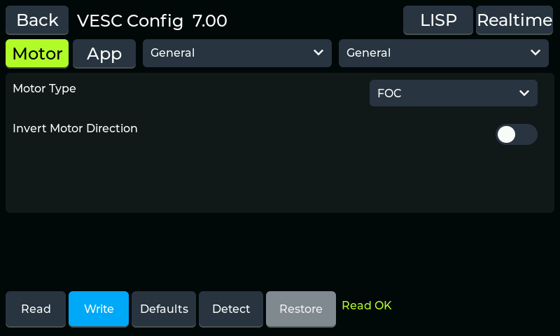

**`VESC` in the dashboard's top bar.** The controller's own configuration
straight from the panel, without a laptop.

- The title shows the controller's firmware version (`VESC Config 7.00`).
- `Motor` / `App` select the parameter set; the two dropdowns select the group
  and sub-group (`General`, `Current`, `Speed`, …).
- Rows are switches, dropdowns and number fields — one per VESC parameter,
  generated from the VESC Tool XML.
- Footer: `Read` (pull the config from the controller), `Write` (push it back),
  `Defaults` (load the controller's defaults), `Detect` (FOC detection wizard),
  `Restore` (bring back the last backup) and a status line (`Read OK`).
- `LISP` and `Realtime` in the header jump to those screens.

## 8. Pedal assist (PAS)

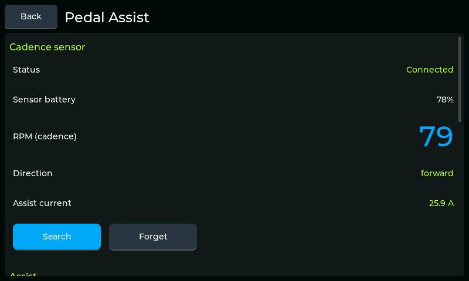

**Settings → Bike → Pedal assist → Open.**

The head unit owns the whole PAS feature — no phone involved.

- **Cadence sensor** — status, battery, live cadence in RPM, rotation direction
  and the assist current it asks for. `Search` pairs a BLE cadence sensor,
  `Forget` drops the pairing.
- **Throttle / assist enabled** — master switch.
- **Reverse rotation** — for a sensor mounted on the other side.
- **Assist level** and **Max current** — how much help, and the ceiling.
- **Mode** — e.g. `Proportional to cadence`.
- **Advanced** — start delay, start current and the rest of the ramp tuning.

## 9. Speed sensor

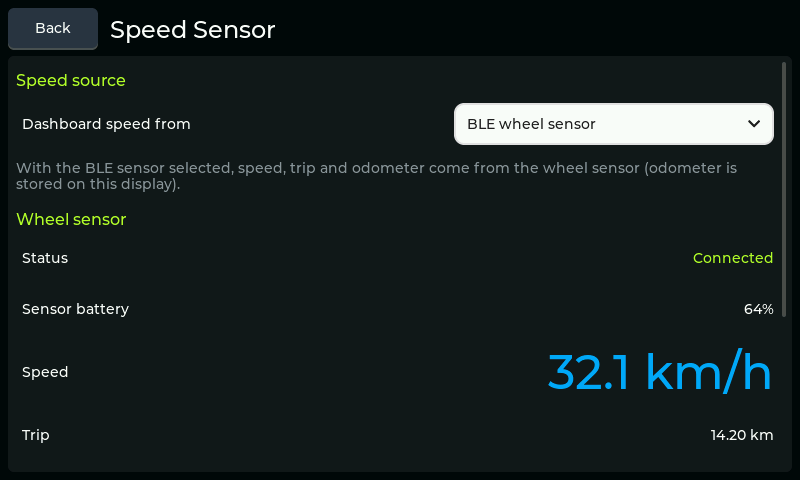

**Settings → Bike → Speed sensor → Open.**

- **Dashboard speed from** — `VESC` (speed from the controller's ERPM) or
  `BLE wheel sensor`. With the sensor selected, speed, trip **and the odometer**
  come from it and are kept on this display.
- **Wheel sensor** — status, battery, live speed, trip and odometer; `Search` /
  `Forget` pair the BLE CSC sensor.
- **Wheel diameter** — outer tyre diameter in mm; also used by the VESC speed
  calculation helper.

## 9a. Battery monitor (JK-BMS)

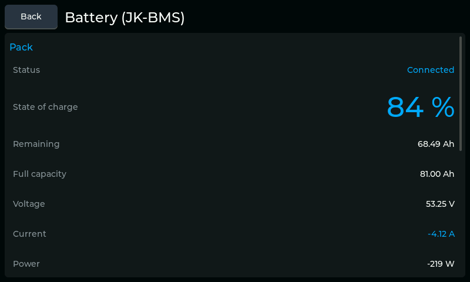

**Settings → Bike → Battery monitor (JK-BMS) → Open**, or tap the battery
percentage on any dashboard. The screen reads a Jikong (JK-BMS) pack over
Bluetooth LE.

- **Status** — `Connected`, `Searching…` or `Not paired`.
- **State of charge** — the pack’s own SOC in large digits.
- **Remaining / Full capacity** — pack Ah counters, not a controller estimate.
- **Voltage / Current / Power** — what the BMS reports. The ride’s motor
  current and power still come from the VESC.
- **Temperatures** — MOSFET, T1 and T2 probes.
- **Cell range** — lowest and highest cell voltage and the delta between them.
- **Cycles / MOSFETs / Model** — cycle count, SOH, charge/discharge FET state
  and the pack model string.

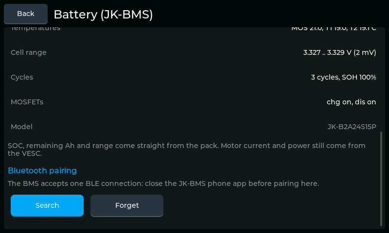

**Bluetooth pairing** — `Search` scans for JK-BMS packs; tap a result to bind
it, `Forget` drops the binding. The BMS accepts only one BLE connection at a
time, so close the phone app before pairing. The chosen pack is saved and
re-bound on the next boot.

Select `JK-BMS (BLE)` under **Battery Calculation** to use the pack for the
dashboard, Android Auto HUD and range estimate. If the selected pack is offline
or its data is stale, SOC, remaining Ah and range show `N/A` rather than an
unrelated controller value.

---

## 10. Quick actions (drawer)

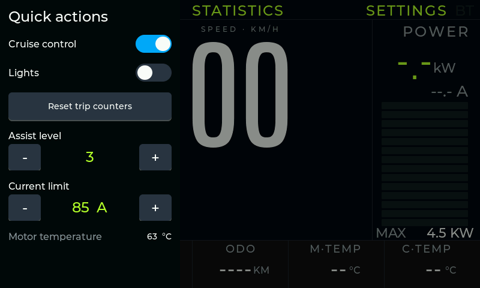

**Swipe right from the left edge of the dashboard.** A drawer over the
dashboard, so the ride data stays visible while you change something.

- `Cruise control` and `Lights` toggles.
- `Reset trip counters`.
- `Assist level` and `Current limit` with −/+ steppers.
- Live motor temperature at the bottom.

Tap anywhere outside the drawer to close it.

## 11. LISP editor

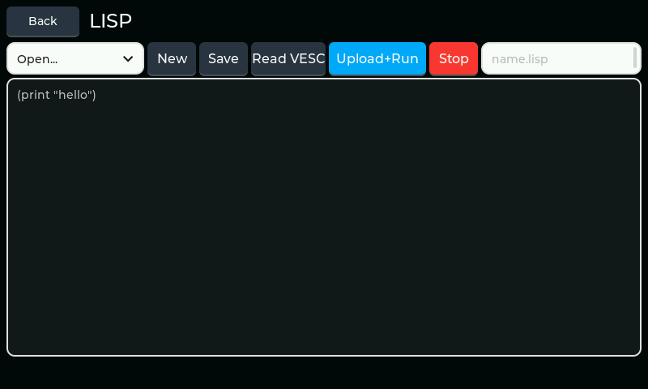

**VESC Config → LISP.**

- `Open…` picks a script already on the device; `New` empties the buffer.
- The text area is editable with the on-screen keyboard (tap it).
- `Save` writes `<name>.lisp` to the device storage; `Read VESC` pulls the
  script currently stored on the controller into the editor.
- `Upload+Run` erases and writes the buffer to the VESC and starts it; `Stop`
  halts the running script.
- The name field gets the `.lisp` suffix added automatically.

## 12. Realtime

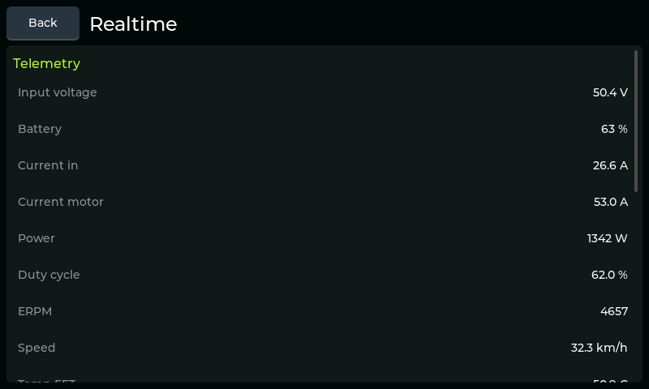

**VESC Config → Realtime.** A live telemetry read-out straight off the
controller — input voltage, battery, currents, power, duty cycle, ERPM, speed,
temperatures and the rest — for when the dashboard tiles are not enough.
Scroll for the full list; `Back` returns.

## 13. QR codes

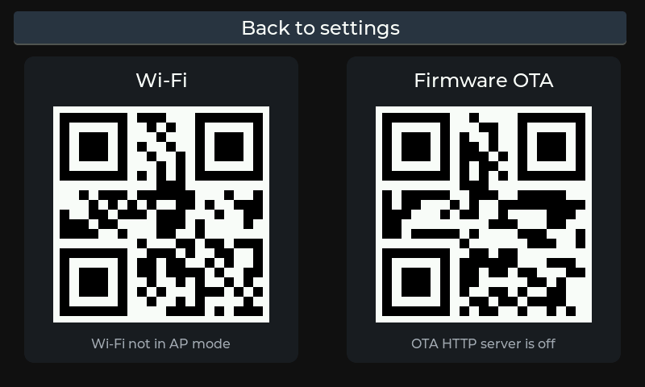

**Settings → System → QR codes.** Two codes for the phone:

- **Wi-Fi** — the head unit's access point, so the companion app can join it
  and push firmware over HTTP. The caption under it says whether the AP is up.
- **Firmware OTA** — the URL of the on-device OTA page. The caption says whether
  the HTTP server is running.

---

## 14. Logs

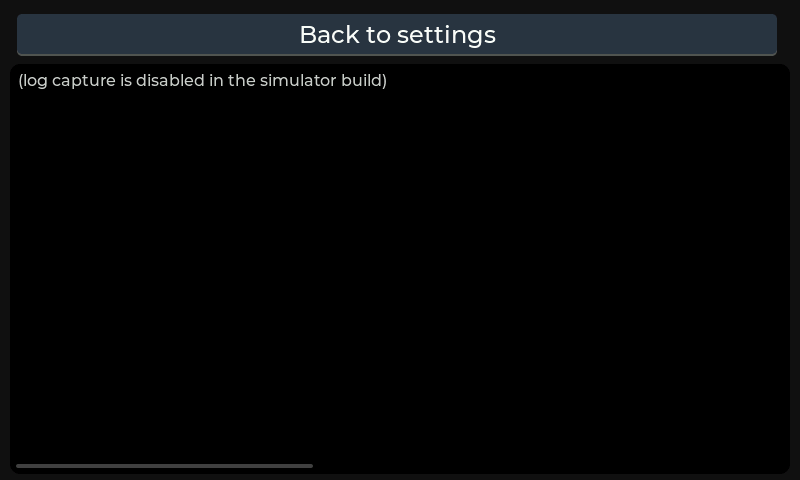

**Settings → System → Logs.** The firmware's own log (the same lines that go to
the UART console), captured in a PSRAM ring buffer so you can read them on the
panel — the first thing to open when something misbehaves away from a laptop.

The list scrolls; new lines follow the tail while you stay at the bottom, and
scrolling up pins the view. `Back to settings` returns.

*(The picture comes from the simulator build, where log capture is switched
off — hence the placeholder text. On the device the ring is full of real
lines.)*

---

## Not in this gallery

- **Android Auto / navigator** — the phone's H.264 stream, decoded straight to
  the panel. Nothing LVGL draws it, so there is nothing to render here.
- **VESC link** (Settings → Connection → Open) — compiles only on the device
  build; it drives the real BLE / Wi-Fi transports.
- **Files** — the file browser lives in `main/files_screen.c` and needs the real
  littlefs / SD card, so the simulator build has no screen to render; the Logs
  screen is included above but shows a placeholder there.
- **Boot splash** — the animated logo before the dashboard appears.

## Regenerating these pictures

```bash
cd Super_VESC_Display/lvgl-simulator
make menus RUN='screen Cockpit; shot 01_dashboard_cockpit'
```

`make menus` builds the real screens headless (SDL's dummy video driver) and
`RUN='…'` drives them: `screen <theme|settings>`,
`menu <trips|vesc|pas|speed|bms|lisp|lispedit|rt>`, `tap "<text>"` / `tap x y`,
`swipe`, `wait <ms>`, `shot <name>`, `audit`. The BMPs land in
`buildmenu/shots/`. The `bms` menu opens the JK-BMS screen; follow it with
`tap "Search"` and `tap "JK-BMS"` to show a connected pack.

On Windows the simulator needs a 32-bit MinGW toolchain plus `make`, `curl` and
`jansson` from MSYS2 (`pacman -S mingw-w64-i686-gcc mingw-w64-i686-curl`), and
`python` on `PATH` as `python3`.
