# Экраны головного устройства — что на них и как этим пользоваться

Все экраны, которые LVGL-дашборд может показать на панели 800×480, с
отрендеренными картинками и описанием органов управления.

Это **не макеты**: картинки сняты с настоящих экранов прошивки, собранных под
хост через `make menus` (`SIM_SHIM=1` — реальный C из
`Super_VESC_Display/custom/` плюс `sim_backend/`, который подменяет CAN, BLE и
флеш). Врут только цифры — на значения не смотрите, смотрите на компоновку.

---

## Жесты, которые работают на любом экране дашборда

| Жест | Что делает |
| --- | --- |
| Тап тремя пальцами | Переключение между дашбордом и экраном телефона (Android Auto или встроенный навигатор — см. *Settings → Connection*, §3.1) |
| Свайп вправо от левого края | Открыть **Quick actions** (§10) |
| Тап мимо выдвижной панели | Закрыть её |
| Горизонтальный свайп по фону дашборда | Яркость экрана (только если включён **Brightness gesture**, §3.2) |
| Тап по `VESC`, `STATISTICS`, `SETTINGS` в верхней строке | Переход в VESC Config, статистику поездок, настройки |

---

## 1. Дашборд — Cockpit

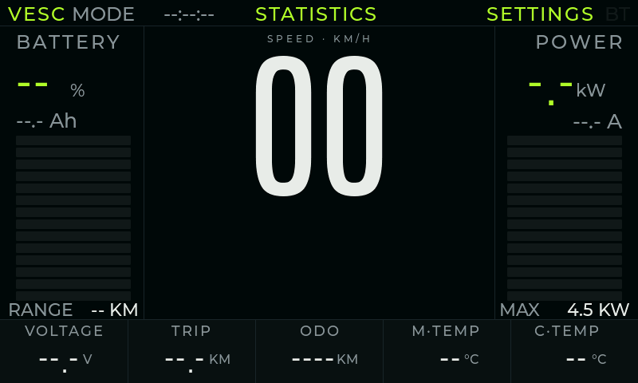

Экран по умолчанию. Один взгляд: сколько заряда, как быстро едем, насколько
тяжело работает контроллер.

- **Верхняя строка** — `VESC` (открывает конфиг VESC Tool), `MODE n` (активный
  профиль скорости LISP-скрипта на VESC), аптайм, `STATISTICS` (журнал
  поездок), `BT` (подсвечен, когда подключён BLE-пир — телефон или датчик),
  `SETTINGS`.
- **BATTERY** (слева) — процент заряда, потраченные Ah и полоса. Число под
  `RANGE` — оценка оставшегося пробега по настроенной ёмкости и недавнему
  расходу.
- **SPEED** (центр) — большие цифры; `MAX 60` — верх шкалы.
- **POWER** (справа) — мгновенная мощность в кВт, ток в амперах и полоса,
  полная шкала которой задаётся через `Power Max` (Settings → Display, §3.2).
- **Нижняя строка** — напряжение батареи, пробег поездки, **одометр** (общий
  пробег, хранится на дисплее), температура мотора и контроллера.

## 2. Дашборд — Classic Max

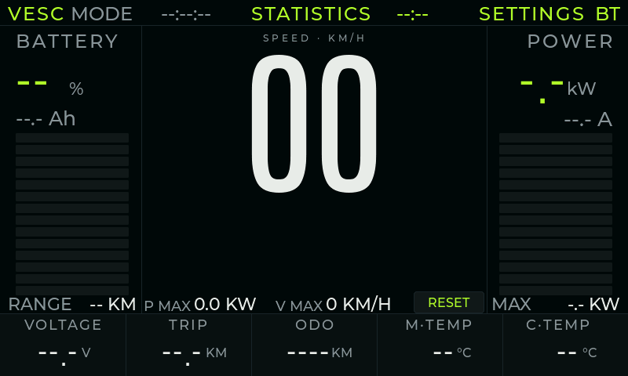

Тот же дашборд с «соревновательными» полями: `P MAX` (пиковая мощность за
поездку), `V MAX` (максимальная скорость) и кнопка `RESET` в нижней строке.

`RESET` обнуляет счётчики поездки (пробег, Wh, время, пиковую мощность,
максимальную скорость). **Одометр не трогается** — это общий пробег.

---

## 3. Настройки

Настройки — один экран с четырьмя вкладками. Всё сохраняется сразу, кнопок
OK / Apply нет.

### 3.1 Connection

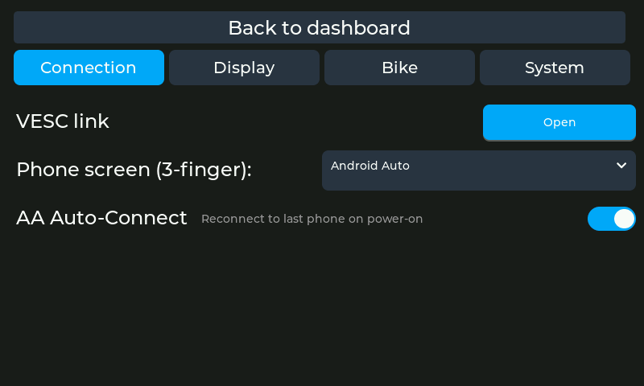

- **VESC link → Open** — экран транспорта: CAN или Bluetooth до контроллера,
  спаривание VESC Express, состояние линка в реальном времени.
- **Phone screen (3-finger)** — что показывает жест тремя пальцами: `Android
  Auto` (проекция телефона) или `Navigator` (карта из приложения-компаньона
  по BLE).
- **AA Auto-Connect** — разрешить BT-агенту подключаться к последнему
  спаренному телефону при включении. Выключено — соединение инициируете с
  телефона.

### 3.2 Display

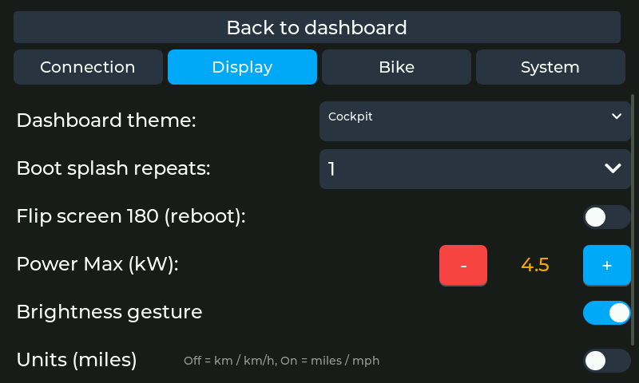

- **Dashboard theme** — `Cockpit` или `Classic Max`, переключается на лету.
- **Boot splash repeats** — сколько раз проигрывается заставка (`Off`…`5`).
- **Flip screen 180 (reboot)** — для перевёрнутого монтажа; применяется после
  перезагрузки.
- **Power Max (kW)** — полная шкала полосы мощности и подпись `MAX`.
- **Brightness gesture** — включить невидимый полноэкранный слайдер яркости
  (горизонтальный свайп по дашборду).
- **Units (miles)** — `Off` = км / км/ч, `On` = мили / миль/ч. Применяется сразу
  к дашборду, статистике поездок и диалогу одометра.
- **Temperature (F)** — `Off` = °C, `On` = °F.

### 3.3 Bike

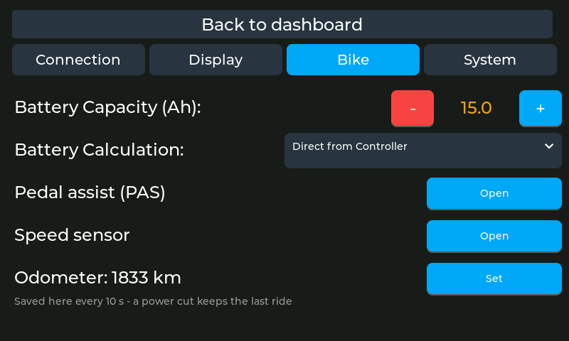

- **Battery Capacity (Ah)** — ёмкость батареи; от неё считаются проценты и
  оценка пробега.
- **Battery Calculation** — `Direct from Controller` (брать процент с самого
  VESC) или `Smart Calculation` (считать Ah туда-обратно по ёмкости с
  детекцией заряда).
- **Pedal assist (PAS) → Open** — экран PAS (§8).
- **Speed sensor → Open** — экран датчика скорости (§9).
- **Odometer → Set** — задать общий пробег заново (§4). Подпись под строкой —
  весь смысл этой функции: пробег сохраняется сюда каждые 10 с, поэтому
  выключение питания не съедает конец поездки.

### 3.4 System

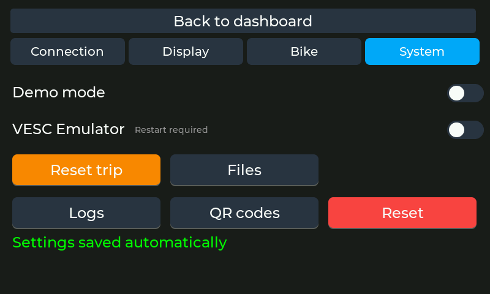

- **Demo mode** — гонять дашборд на синтетических значениях (выставки, фото).
- **VESC Emulator** — делать вид, что на шине есть контроллер; нужен рестарт.
- **Reset trip** — то же, что `RESET` на дашборде.
- **Files** — файловый браузер на устройстве (littlefs / SD-карта).
- **Logs** — просмотр логов из PSRAM-кольца.
- **QR codes** — QR-коды Wi-Fi и OTA-прошивки (§13).
- **Reset** — сброс всех настроек к значениям по умолчанию. Одометр,
  спаренные датчики и журнал поездок намеренно переживают этот сброс.
- Ниже кнопок: версии прошивок (хост / BT-агент / C6) и состояние шины CAN.

---

## 4. Диалог установки одометра

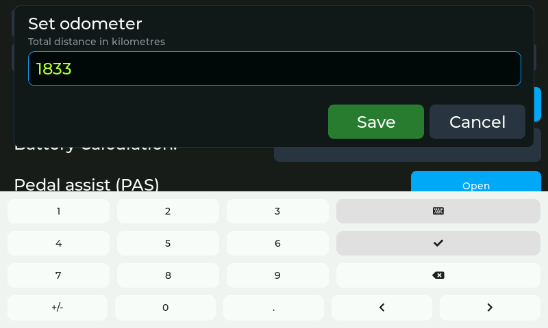

**Settings → Bike → Odometer → Set.**

Модальное окно поверх настроек с цифровой клавиатурой. Нужно, когда общий
пробег перестал соответствовать реальности: заменили контроллер, поменяли
раму, перепрошивали VESC. Значение вводится в ваших единицах (км или мили),
запятая — десятичный разделитель, перед сохранением число пересчитывается.

`Save` записывает, `Cancel` (или ✕ на клавиатуре) оставляет пробег как был.
Дальше число живёт на дисплее: поле `ODO` на дашборде и этот диалог всегда
показывают одно и то же.

Диалог правит тот одометр, который показывает дашборд — зеркало VESC или
одометр BLE-датчика колеса, если выбран он как источник скорости.

## 5. Статистика поездок — список

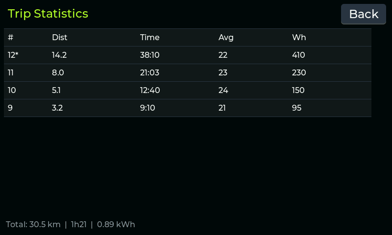

**`STATISTICS` в верхней строке дашборда.**

- Сначала новые поездки; `*` помечена та, что пишется прямо сейчас.
- Колонки: пробег, длительность, средняя скорость, энергия (Wh).
- В подвале — сумма по всему, что ещё лежит в разделе `triplog` (примерно
  11 суток включённого времени при выборке раз в 10 с).
- `Back` — назад на дашборд.

## 6. Статистика поездок — детали

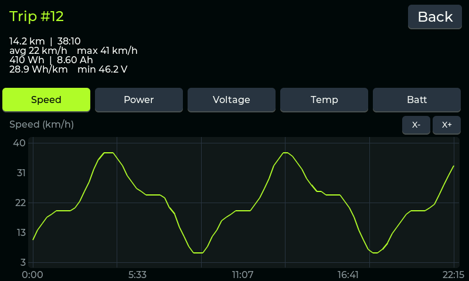

Тап по любой строке списка.

- Шапка: пробег, длительность, средняя и максимальная скорость, энергия и
  заряд (Wh / Ah), эффективность (Wh на км или милю) и минимальное напряжение
  батареи.
- Пять вкладок метрики — `Speed`, `Power`, `Voltage`, `Temp`, `Batt` (вторая
  вкладка температуры появляется, если включена вторая голова) — каждая
  перерисовывает график той же поездки.
- `X÷` / `X+` — масштаб по времени; после приближения график можно тянуть
  влево-вправо.
- `Delete` спрашивает подтверждение и убирает поездку из журнала. Текущую
  поездку (`*`) удалить нельзя.

---

## 7. VESC Config

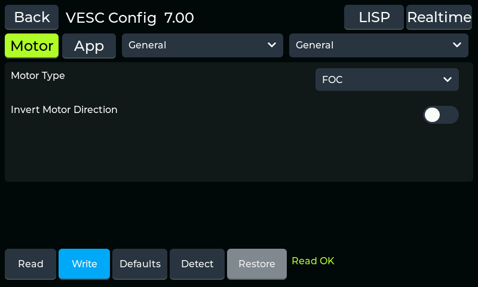

**`VESC` в верхней строке дашборда.** Конфигурация контроллера прямо с панели,
без ноутбука.

- В заголовке — версия прошивки контроллера (`VESC Config 7.00`).
- `Motor` / `App` выбирают набор параметров; два выпадающих списка — группу и
  подгруппу (`General`, `Current`, `Speed`, …).
- Строки — переключатели, списки и числовые поля, по одному на параметр VESC;
  сгенерированы из XML VESC Tool.
- Внизу: `Read` (забрать конфиг с контроллера), `Write` (записать обратно),
  `Defaults` (заводские значения контроллера), `Detect` (мастер FOC-детекта),
  `Restore` (вернуть последний бэкап) и строка состояния (`Read OK`).
- `LISP` и `Realtime` в заголовке ведут на соответствующие экраны.

## 8. Pedal assist (PAS)

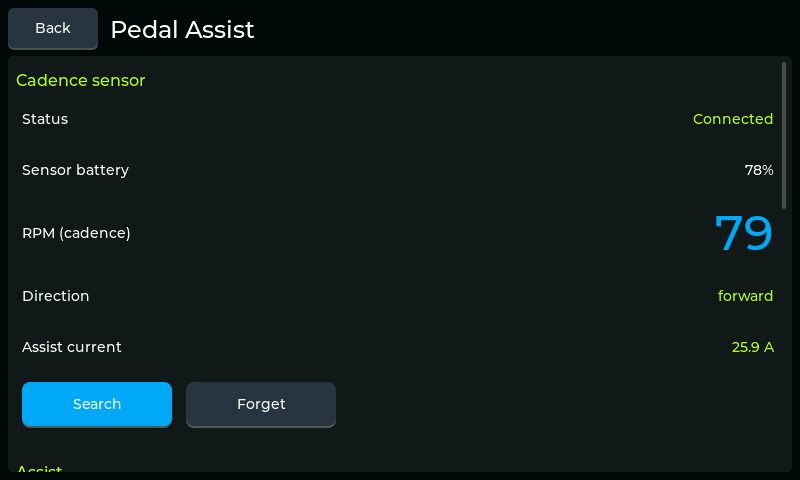

**Settings → Bike → Pedal assist → Open.**

Вся функция PAS живёт на головном устройстве — телефон не нужен.

- **Cadence sensor** — статус, батарея, текущий каденс в RPM, направление
  вращения и ток ассиста, который он просит. `Search` спаривает BLE-датчик
  каденса, `Forget` забывает его.
- **Throttle / assist enabled** — общий выключатель.
- **Reverse rotation** — если датчик стоит с другой стороны.
- **Assist level** и **Max current** — сколько помогать и до какого предела.
- **Mode** — например, `Proportional to cadence`.
- **Advanced** — задержка старта, стартовый ток и остальная настройка разгона.

## 9. Датчик скорости

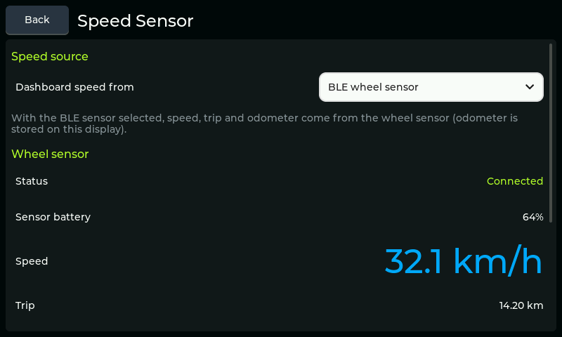

**Settings → Bike → Speed sensor → Open.**

- **Dashboard speed from** — `VESC` (скорость по ERPM контроллера) или
  `BLE wheel sensor`. Если выбран датчик, скорость, пробег поездки **и
  одометр** берутся с него и хранятся на этом дисплее.
- **Wheel sensor** — статус, батарея, текущая скорость, пробег и одометр;
  `Search` / `Forget` спаривают и забывают BLE-датчик CSC.
- **Wheel diameter** — внешний диаметр колеса в мм; его же использует
  помощник расчёта скорости в VESC.

---

## 10. Quick actions (выдвижная панель)

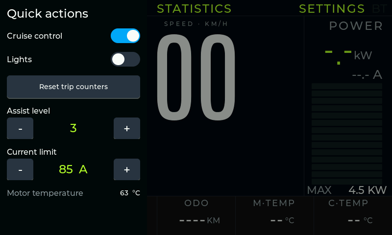

**Свайп вправо от левого края дашборда.** Панель поверх дашборда, чтобы
данные поездки оставались на виду, пока вы что-то меняете.

- Переключатели `Cruise control` и `Lights`.
- `Reset trip counters`.
- `Assist level` и `Current limit` со степперами −/+.
- Внизу — живая температура мотора.

Тап мимо панели закрывает её.

## 11. Редактор LISP

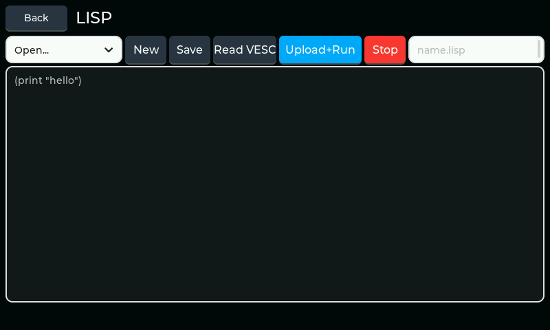

**VESC Config → LISP.**

- `Open…` выбирает скрипт, уже лежащий на устройстве; `New` очищает буфер.
- Текст редактируется экранной клавиатурой (тап по полю).
- `Save` пишет `<имя>.lisp` в хранилище устройства; `Read VESC` забирает
  скрипт, который сейчас лежит на контроллере, в редактор.
- `Upload+Run` стирает и записывает буфер в VESC и запускает его; `Stop`
  останавливает выполняющийся скрипт.
- К имени файла автоматически дописывается `.lisp`.

## 12. Realtime

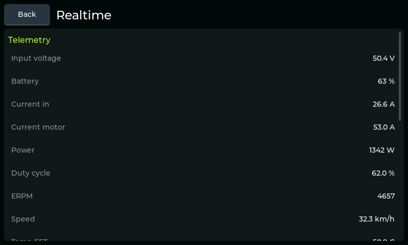

**VESC Config → Realtime.** Живая телеметрия прямо с контроллера —
напряжение на входе, батарея, токи, мощность, скважность, ERPM, скорость,
температуры и остальное — на случай, когда плиток дашборда не хватает.
Список прокручивается, `Back` возвращает назад.

## 13. QR-коды

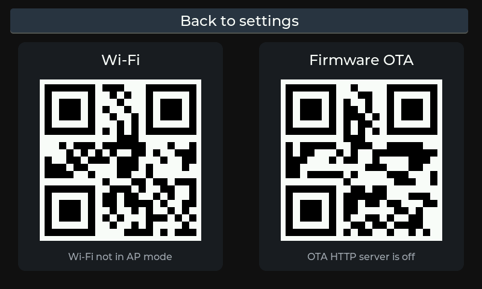

**Settings → System → QR codes.** Два кода для телефона:

- **Wi-Fi** — точка доступа головного устройства, чтобы приложение-компаньон
  подключилось к ней и залило прошивку по HTTP. Подпись под кодом говорит,
  поднята ли точка доступа.
- **Firmware OTA** — адрес страницы OTA на устройстве. Подпись говорит,
  запущен ли HTTP-сервер.

---

## 14. Логи

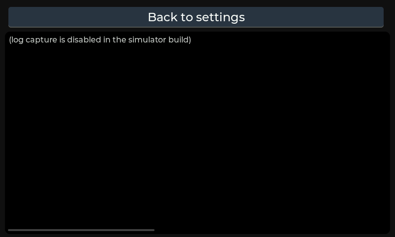

**Settings → System → Logs.** Собственный лог прошивки (те же строки, что
уходят в UART-консоль), собранный в PSRAM-кольцо, — первое, что стоит открыть,
когда что-то ведёт себя странно вдали от ноутбука.

Список прокручивается; новые строки догоняют хвост, пока вы внизу, а
прокрутка вверх фиксирует вид. `Back to settings` возвращает в настройки.

*(Картинка из симулятора, где захват логов выключен — отсюда текст-заглушка.
На устройстве в кольце лежат настоящие строки.)*

---

## Чего здесь нет

- **Android Auto / навигатор** — H.264-поток с телефона, декодируемый сразу в
  панель. LVGL его не рисует, рендерить нечего.
- **VESC link** (Settings → Connection → Open) — собирается только в
  device-сборке: он работает с настоящими транспортами BLE / Wi-Fi.
- **Files** — файловый браузер живёт в `main/files_screen.c` и требует
  настоящего littlefs / SD-карты, поэтому в симуляторе рисовать нечего; экран
  логов выше есть, но в симуляторе он показывает заглушку.
- **Boot splash** — анимированный логотип перед появлением дашборда.

## Как перегенерировать картинки

```bash
cd Super_VESC_Display/lvgl-simulator
make menus RUN='screen Cockpit; shot 01_dashboard_cockpit'
```

`make menus` собирает настоящие экраны без окна (SDL dummy video driver), а
`RUN='…'` ими управляет: `screen <theme|settings>`,
`menu <trips|vesc|pas|speed|lisp|lispedit|rt>`, `tap "<text>"` / `tap x y`,
`swipe`, `wait <ms>`, `shot <name>`, `audit`. BMP-файлы кладутся в
`buildmenu/shots/`.

Под Windows симулятору нужен 32-битный тулчейн MinGW и `make`, `curl`,
`jansson` из MSYS2 (`pacman -S mingw-w64-i686-gcc mingw-w64-i686-curl`), а
`python` должен быть доступен как `python3`.
